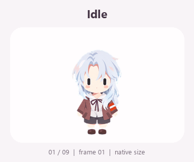
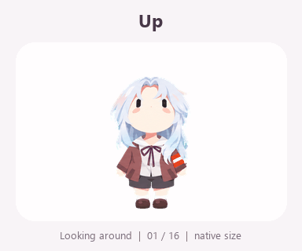

# Yinling Pet · 银铃

[简体中文](README.md) · [Installation](INSTALL.md) · [Asset license](LICENSE-ASSETS.txt)

A silver-haired chibi companion with capsule eyes, a brown jacket and a purple ribbon. The pack follows the Codex / ChatGPT Pets v2 atlas layout: **9 states, 16 look directions and 73 frames**.

**MIT-licensed tools · Character assets free for personal noncommercial use**



## Download

Open this repository's **Releases**. Download `yinling-v1.0.0.zip` for the ready-to-use pack, `yinling-v1.0.0.png` for the full atlas, or `yinling-source-v1.0.0.zip` for source frames and tools. `SHA256SUMS.txt` contains download checksums.

The [sprite sheet](assets/yinling/spritesheet.png) is also available directly. Follow [INSTALL.md](INSTALL.md) to import it through a session with Pets tools enabled.

## Format

The transparent PNG is **1536 × 2288**: 8 columns, 11 rows, 192 × 208 cells. The pack includes idle, right/left movement, waving, jumping, disappointment, waiting, focused work, review and a clockwise gaze loop. [pet.json](assets/yinling/pet.json) describes the timing and layout.



## Build and verify

Python 3.11+ is required for maintenance tools.

```sh
python -m pip install -r requirements.txt
python scripts/validate.py --verify-hash
python -m unittest discover -s tests -v
python scripts/build_release.py
```

Release files are written to `dist/`. See [development and publishing](docs/DEVELOPMENT.md).

## Provenance and licensing

Artwork was produced with AI image generation using publisher-supplied design references. See [CREDITS.md](CREDITS.md). Prompts are production briefs; fresh generation may vary.

Tools, tests and prose use [MIT](LICENSE). Character artwork, frames and visual previews use the [personal noncommercial asset license](LICENSE-ASSETS.txt). Commercial use and public redistribution of modified character assets require separate written permission. Contributions are described in [CONTRIBUTING.md](CONTRIBUTING.md).
