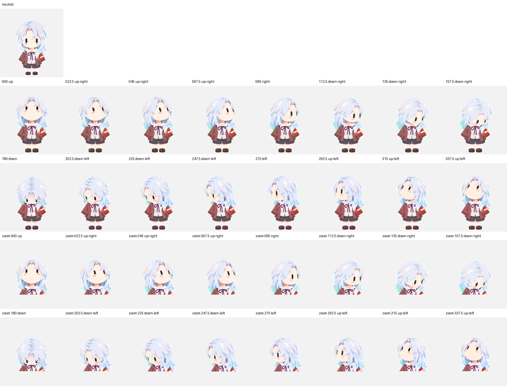

# 图集格式 / Atlas format

本项目提供 Pets v2 布局的透明 PNG，以及供维护工具使用的公开 JSON 配置。宿主应用决定动画触发与实际播放时长。

| 项目 | 值 |
| --- | --- |
| PNG | RGBA，1536 × 2288 |
| 网格 | 8 列 × 11 行 |
| 单元格 | 192 × 208 |
| 有效帧 | 73 |
| 空白单元格 | 15，全透明 |
| 坐标 | 左上角原点，x 向右、y 向下 |

行与列采用从 0 开始的编号。第 `row` 行、第 `column` 列的区域：

```text
x = column × 192
y = row × 208
width = 192
height = 208
```

## 动作行

| 行 | 状态键 | 帧数 | 表现 |
| --- | --- | --- | --- |
| 0 | idle | 6 | 待机、眨眼 |
| 1 | running-right | 8 | 向屏幕右侧行走 |
| 2 | running-left | 8 | 向屏幕左侧行走 |
| 3 | waving | 4 | 挥手 |
| 4 | jumping | 5 | 准备、起跳、腾空、下降、落地 |
| 5 | failed | 8 | 失落 |
| 6 | waiting | 6 | 期待等待 |
| 7 | running | 6 | 专注思考、工作 |
| 8 | review | 6 | 检查成果 |
| 9 | look-row-9 | 8 | 注视 0° 至 157.5° |
| 10 | look-row-10 | 8 | 注视 180° 至 337.5° |

`running` 是宿主状态名，在此角色中表现为专注工作。横向移动使用 `running-right` 与 `running-left`。

每行动作从第 0 列开始，有效帧数后的单元格保持全透明。`durations_ms` 给出逐帧预览时长；宿主可采用自己的时序。

## 注视方向

屏幕角度从上方开始顺时针递增：0° 上、90° 右、180° 下、270° 左。相邻方向相差 22.5°。

```text
row 9:   0, 22.5, 45, 67.5, 90, 112.5, 135, 157.5
row 10: 180, 202.5, 225, 247.5, 270, 292.5, 315, 337.5
```

正面中立姿势使用待机行。注视通过头部、脸部和头发的自然转动表达，躯干与双脚保持稳定。



## 公开配置

`pet.json` 使用本项目的维护配置格式 `yinling-pet/1`。`atlas.file` 相对该 JSON 所在目录，`source_directory` 相对源码仓库根目录。配置记录尺寸、哈希、有效帧、预览时长和角度；平台导入使用完整 PNG。

The manifest is this project's maintenance format. The PNG uses the Pets v2 layout. Row/column indexes are zero-based; the atlas filename is relative to the manifest. Frame source directories are relative to the repository root. Preview timing is advisory and may differ from host playback.
